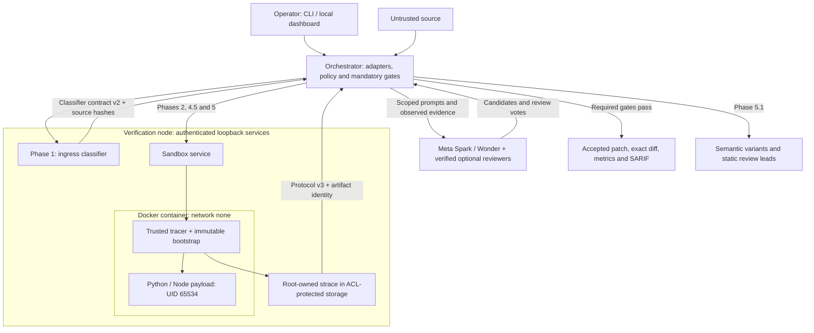

# AgentWard + MuseVerify

**Reproduce the vulnerability. Verify the repair. Keep the evidence.**

AgentWard + MuseVerify is a Meta-primary security harness for Python and single-file JavaScript/TypeScript Node modules. It addresses two connected problems: candidate vulnerability alerts need evidence before maintainers spend time fixing them, and coding agents need containment when they read untrusted source or propose changes.

**AgentWard** controls source ingress, tool-action policy, operator restrictions and workspace rewind. **MuseVerify** reproduces supported exploits in Docker, generates candidate repairs, checks them with independent reviewers and Purple Llama CodeShield, and tests them against adversarial replay and regression probes.

> Model advice can propose a repair. Only the orchestrator can accept it, after the required policy, AST, scanner and runtime evidence gates pass. No model response can waive a gate.

Meta is mandatory for live runs: **`muse-spark-1.3`** leads policy checks and patch synthesis; **`muse-wonder-1.0`** leads semantic root-cause analysis and variant hunting. The supplied configuration restricts all provider calls to these two models. Anti-Gravity and Custom BYOK reviewers require explicit operator configuration. The acceptance rule is enforced in code; model judgments within that rule remain probabilistic.

**Recorded acceptance, 1 November 2026:** 99 tests passed with real Docker and no skips. Live execution of all 13 Node corpus targets produced **8 `REMEDIATED`, 4 `FALSE_POSITIVE`, and 1 `INCONCLUSIVE`**, with 24 self-play scenarios neutralized and no survivors. These are results for the tested corpus, not a general detection-accuracy claim.

[Acceptance record](docs/CORPUS_ACCEPTANCE_2026-11-01.md) · [PDF project guide](output/pdf/AgentWard_MuseVerify_Project_Guide.pdf) · [HTML project guide](output/pdf/AgentWard_MuseVerify_Project_Guide.html) · [Threat model](docs/THREAT_MODEL.md)

## Why the two systems belong together

An alert is a candidate finding, and an AI-generated patch is a candidate repair. Treating either as proof creates unnecessary triage work or accepts changes that have not preserved the original behavior. At the same time, instructions hidden in comments and literals can try to redirect an agent toward credential access, destructive actions or fabricated audit results.

The project separates those decisions. Ingress checks instruction risk; the sandbox checks supported exploit behavior; runtime policy controls the permitted workflow; independent review and regression determine whether a candidate earns a verified result. Incomplete evidence stays blocked, rejected or inconclusive. Accepted patches remain separate from the intentionally vulnerable benchmarks so an engineer can inspect the exact diff and its evidence before integration.

## Architecture and the seven-phase verification chain

The CLI and dashboard share [main_pipeline.py](main_pipeline.py). Language adapters, policy state and evidence checks are the same in both entry points.



The node authenticates requests and binds returned evidence to the submitted artifacts. Its host kernel, Docker daemon, service, image, tracer and bootstrap remain trusted dependencies. Hashes bind content; they are not signatures or a proof of semantic correctness. See the [threat model](docs/THREAT_MODEL.md) for the complete boundary inventory.

### Phase 1 — Source-aware ingress shield

[agentward_stage1.py](agentward_stage1.py) requires the exact classifier contract from [ingress_guard.py](ingress_guard.py). The pinned model is `Horizon-Labs/prompt-injection-guard-small` at revision `5ed691c28fc37db51f4e80fb81311b7d2b5d4646`; [security/ingress-model.lock.json](security/ingress-model.lock.json) records SHA-256 hashes for all five loaded artifacts. Loading uses safetensors, disables remote model code and performs no inference-time downloads.

Bounded parser facts precede the complete source. Inference uses **512-token windows, 128-token overlap, a 0.40 risk threshold, and at most 256 windows per original or sanitized input**. The sanitizer recognizes instruction patterns in supported comments/literals, including decoded base64; modified source must receive a complete rescan. Valid syntax or a familiar filename never grants automatic approval.

Contract v2 binds model/policy identity, language, source hashes and complete coverage. Classified attacks return `BLOCKED`; unavailable or mismatched evidence returns `UNVERIFIED`. Short HTTP 429 capacity delays permit at most three identical client requests; retries never bypass validation. [Ingress details and regression evidence](docs/INGRESS_GUARD.md).

### Phase 2 — Multi-language Docker and strace triage

[museverify_stage2.py](museverify_stage2.py) creates a disposable source workspace and sends deterministic probes to [sandbox_server.py](sandbox_server.py). These directories are isolated copies under `worktrees/`, not Git worktree checkouts. Production requires `agentward-sandbox:multilang-v3` and protected evidence protocol v3; there is no production host-execution fallback.

The Docker node uses `--network none`, a read-only root filesystem, 256 MiB memory/swap ceilings, PID/CPU limits and a 64 MiB writable workspace. A trusted tracer starts before the submitted code. An immutable bootstrap clears supplementary groups and drops the payload to **UID/GID 65534 with empty effective/permitted capabilities**. The root-owned strace output lives in a separate POSIX-ACL-protected directory. Protocol v3 binds the source/harness SHA-256 digests, filename, language and runtime.

The recorded image contains **Python 3.12.16 and Node 24.22.2**; the [Dockerfile](security/Dockerfile.sandbox) follows Python 3.12 and Node 24 image tags, so future rebuilds may contain newer patch releases. The node requires rootful Linux Docker without user-namespace remapping and an ACL-capable temporary filesystem.

Phase 2 distinguishes reproduced exploits from valid executions with no observed exploit. **Benign controls become `FALSE_POSITIVE` after mandatory Phase 3 policy review**, then skip patch synthesis and later repair stages. Missing execution evidence remains `INCONCLUSIVE`. For Node, static findings outside SQL/command probe coverage also remain `INCONCLUSIVE`; safe SQL probes cannot dismiss a weak-randomness finding.

### Phase 3 — Runtime policy, steering and rewind

[agentward_stage3.py](agentward_stage3.py) screens proposed tool actions using command patterns, high-entropy-string checks and an estimated token budget, then runs concurrent ensemble policy and trajectory reviews. Spark leads the live policy/secret-exfiltration assessment; known credential values are redacted from action text. [enforce_permissions.py](enforce_permissions.py) also provides a JSON `PreToolUse` hook for command-bearing arguments.

These are **application tool-action hooks**, not a kernel syscall interceptor. In the pipeline, final Phase 3 authorization consumes the completed Phase 2 evidence before candidate synthesis; an earlier policy checklist is preparation only. `strace` supplies observations inside Docker.

The guard checkpoints top-level workspace files with a SHA-256 manifest. `trigger_rewind` restores checkpoint copies and removes newly created top-level files on denial. It does not roll back arbitrary host effects or Git history. `POST /api/steer` adds session restrictions; a changed policy revision invalidates in-flight approval. Recognized subprocess/path restrictions have AST enforcement, while broader natural-language restrictions also depend on model review.

### Phase 4 — Patch synthesis, type erasure, CodeShield and tripwires

In [museverify_stage4.py](museverify_stage4.py), Spark proposes a repair that preserves public signatures and sync/async contracts. The AST must contain a reachable decoy equality guard and a logger, such as `_tripwire()` emitting `TRIPWIRE`. A comment mentioning a canary is insufficient.

The gate checks static source-to-sink paths and introduced hazards, gathers valid independent votes from the selected co-auditors concurrently, and runs Purple Llama CodeShield. For TypeScript, Tree-sitter erases supported type-only syntax and reparses the result as JavaScript **before CodeShield scans the JavaScript source**. Docker always tests the original TypeScript candidate through Node 24's native loader. Scanner errors fail closed.

Python analysis includes bounded import-aware taint, call/return propagation and concurrency/TOCTOU review leads. Node taint is intraprocedural; multi-file Node execution and cross-file taint propagation are not established capabilities. A clean static scan supplements runtime evidence. Reviewers approve only the Phase 4 candidate; they cannot declare later regression complete.

### Phase 4.5 — Bounded adversarial self-play

[adversarial_selfplay.py](adversarial_selfplay.py) and [ecmascript_harness.py](ecmascript_harness.py) replay variants against both original and patched source in the sandbox. Node uses three deterministic scenarios: SQL/command syntax mutation, stored-value replay and URL-encoding replay. Python also supports bounded model-proposed scenarios executed by deterministic harnesses.

Zero surviving mutations is necessary but insufficient: required evidence and original-code positive controls must also succeed. Every Node scenario must be neutralized; unsupported or unproven scenarios are never counted as neutralized. Replay adapters test the supplied behavior, not arbitrary persistence or all second-order vulnerabilities.

### Phase 5 — Three-part regression and accepted artifacts

The [orchestrator](main_pipeline.py) replays the candidate in Docker and requires the tested normal behavior to be preserved, the exploit to be blocked, and the AST-recognized tripwire to fire for its decoy while staying silent on the tested normal input. Node normal regression compares the original return value for `agentward_normal`.

Only then are the patched file and unified diff published under `patches/<run-id>/`. Review a generated diff against the unchanged source before integrating it:

```bash
# Replace this value with diff.diff_path from your completed run record.
AGENTWARD_PATCH_DIFF='patches/<run-id>/<stem>_patched.diff'
git apply --check "$AGENTWARD_PATCH_DIFF"
```

`git apply --check` is an integration check, not an automatic runtime gate in the current pipeline. The recorded corpus acceptance went further: each accepted diff was applied in a temporary directory and the result matched the saved patch exactly. A verified repair establishes the tested behavior, not production-wide correctness.

### Phase 5.1 — Semantic variant hunting

[semantic_hunter.py](semantic_hunter.py) uses Wonder to extract the root cause and review related sources with the active ensemble. Python's bounded import/call graph supports multi-hop analysis; Node siblings receive static and model review with explicit coverage limits. Variants, concurrency concerns and unsupported assumptions are review leads, not additional runtime-verified repairs.

Phase 2 overlaps with graph construction and the policy baseline. The pipeline caps concurrent sandbox work at three containers. [Detailed language and verification rules](docs/LANGUAGES.md).

## Multi-language support matrix

| Language | Extensions | Supported execution and analysis |
| --- | --- | --- |
| Python | `.py` | Python AST, bounded cross-file analysis and existing benchmark probes |
| JavaScript | `.js`, `.mjs`, `.cjs` | Single-file CommonJS/ES modules; exported SQL/command functions executed in Node 24 |
| TypeScript | `.ts`, `.mts`, `.cts` | Same Node contract; erasable annotations, interfaces, aliases, generics and assertions; JavaScript preparation for scanning |

Node targets must expose **one scalar argument per probed function**, a serializable return value and complete compatible coverage of all exports, up to eight. The corpus uses built-in modules such as `node:sqlite` and `node:child_process`. Every export must succeed for `agentward_normal` inside the network-disabled sandbox. `cwe_78_cmd_ping.cts` therefore echoes a diagnostic host with `printf` while preserving its intentional shell-injection defect.

This is support for defined target contracts, not arbitrary applications. npm dependencies, project builds, TSX/JSX, classes requiring construction and non-erasable TypeScript transformations are outside this scope. The adapter does not perform TypeScript type checking.

| Result | Meaning |
| --- | --- |
| `UNSUPPORTED_LANGUAGE` | Extension outside the registry |
| `INVALID_SOURCE` | Source cannot parse for the selected language |
| `UNSUPPORTED_TARGET` | Language is recognized but complete compatible Node probes cannot be constructed |
| `INCONCLUSIVE` | Execution/evidence is incomplete, or a Node static weakness lacks matching runtime coverage |

See [language_adapters.py](language_adapters.py), [ecmascript_harness.py](ecmascript_harness.py) and [docs/LANGUAGES.md](docs/LANGUAGES.md).

## Meta-primary ensemble and configuration

[ai_provider.py](ai_provider.py) requires both Meta models to pass pre-flight. The supplied configuration sets `AGENTWARD_META_ONLY=1` and `ENSEMBLE_MODE=meta_only`: only `muse-spark-1.3` and `muse-wonder-1.0` may receive requests. Anti-Gravity and Custom are marked `DISABLED` without connectivity probes. Direct calls and dashboard mode changes cannot override this file-level restriction.

Dashboard discovery is cached for 60 seconds; `GET /api/providers?force_refresh=true` reloads configuration and retests it. An active run retains its successful snapshot while configuration remains unchanged. Provider-policy changes invalidate the cached snapshot. An operator must explicitly set `AGENTWARD_META_ONLY=0` in `.env` to enable the optional routing modes below.

| `ENSEMBLE_MODE` | Requested participants |
| --- | --- |
| `auto` | Meta primary plus every healthy secondary |
| `all_three` | Meta, Anti-Gravity and Custom; unavailable secondaries are explicitly excluded |
| `meta_plus_agy` | Meta plus verified Anti-Gravity |
| `meta_plus_custom` | Meta plus verified Custom BYOK |
| `meta_only` | Spark and Wonder cross-checking each other |

If no requested secondary is healthy, the other native Meta model supplies independent review. `all_three` is a routing preference, not a requirement that three providers always participate. Missing Meta blocks a live run. Once a reviewer is selected, a failed or malformed response cannot become an implicit approval.

Start from [.env.example](.env.example); keep the populated `.env` local:

| Variable | Purpose / default |
| --- | --- |
| `META_API_KEY` | Required Meta credential |
| `META_API_BASE_URL` | `https://api.meta.ai/v1` |
| `AGENTWARD_META_ONLY` | `.env` policy: `1` restricts pre-flight, routing and calls to the two Meta models; supplied example uses `1` |
| `ENSEMBLE_MODE` | Supplied example uses `meta_only`; optional modes require `AGENTWARD_META_ONLY=0` |
| `AGY_BIN` | Optional CLI path; otherwise PATH or `~/.local/bin/agy` |
| `AGY_SELECTED_MODEL` | Preferred high-end model, default `gemini-4-argon` |
| `AGY_PREFLIGHT_TIMEOUT_S` | Per-model probe deadline, capped at 30 seconds |
| `CUSTOM_API_URL` | Compatible Responses/Chat Completions endpoint or `/v1` base |
| `CUSTOM_API_KEY`, `CUSTOM_MODEL_NAME` | BYOK credential and endpoint-supported model identifier |
| `CUSTOM_REASONING_EFFORT` | Default `medium`, for models/endpoints supporting the parameter |
| `CUSTOM_SERVICE_TIER` | Optional `fast` / `ultrafast`, where supported |
| `AI_TIMEOUT_S`, `AGY_TIMEOUT_S` | Task deadlines; defaults 120 / 180 seconds |
| `AGENTWARD_INGRESS_URL` | Authenticated node's `/scan-ingress` URL |
| `AGENTWARD_SANDBOX_URL` | Required sandbox origin in the project's `.env`; no localhost/environment fallback |
| `AGENTWARD_NODE_TOKEN` | Shared random node secret, at least 32 characters |

When optional providers are explicitly enabled, Anti-Gravity tries the selected supported high-end model, then the deduplicated cascade `gemini-4-argon`, `claude-opus-5-5`, `claude-sonnet-5.5`, `gemini-3.8`. Quota failures are recorded during pre-flight. CLI probes are bounded; permission-bypass flags are not used. A later task failure denies that task's review.

Custom BYOK supports the implemented OpenAI-compatible HTTP shapes, not every provider-specific protocol. Its five-second pre-flight requires HTTP 200 and nonempty, complete content. Placeholder keys, authentication errors, timeouts and missing endpoints exclude it. `/api/providers` returns status and topology without credential values.

[runtime_config.py](runtime_config.py) reads the `.env` beside the application modules, regardless of the shell's working directory. Its required sandbox URL takes precedence over inherited values and replaces the obsolete `AGENTWARD_SANDBOX_PROXY_URL`. It derives `/health`, `/execute` and `/run-sandbox-test` with `urljoin`; existing URLs ending in those routes remain accepted. Missing/malformed URLs fail before sending a request. Live runs check Docker/protocol-v3 health before provider pre-flight, then still require authenticated execution and protected artifact-bound trace evidence.

## Verified results and security hardening

| Evidence | Recorded result | Scope |
| --- | --- | --- |
| Routing/provider regression, 3 November | **100 passed, 12 optional Docker tests skipped** out of 112 discovered | Includes configuration and provider-policy regressions; Ruff, dependency and deployment-shell checks passed |
| Live Meta-only run, 3 November | **`cwe_78_cmd.js` remediated; 13 Meta calls; 3 self-play attacks neutralized; 1 verified SARIF fix** | One command benchmark with real ingress and authenticated protocol-v3 Docker; only Spark and Wonder participated |
| Full test suite, 1 November | **99 passed, zero skipped** | Includes opt-in real Docker tests; model fixtures in unit tests are not live-provider proof |
| Live Node corpus, 1 November | **13 targets: 8 repaired, 4 false positives, 1 inconclusive** | Real classifier, Meta Spark/Wonder and authenticated remote Docker |
| Static/normal contracts | **13 parse; 6 TypeScript transforms/scans; 17 exports execute normally** | All six Node extensions; no unsupported/invalid corpus targets |
| Corpus ingress | **13 unchanged-source `ALLOW`** | Highest measured injection score 0.017127, below 0.40 |
| Node self-play and artifacts | **24 neutralized, 0 survivors; 8 verified SARIF fixes** | Patch hashes match regression evidence; all diffs reconstruct saved patches |
| Classifier regression, 31 October | **78/78: 45 benign + 33 malicious cases** | Real pinned-model inference; development regression corpora, not untouched holdout accuracy |
| Protocol-v3 deployment, 31 October | **25 acceptance groups** | Auth, all seven extensions, artifact binding and isolation; repair controls in that record used fixtures |
| Community skill inventory | **818 pinned skill trees** | Installation integrity and provenance; engineering guidance, not runtime instructions or compliance certification |

The current corpus has eight command/SQL vulnerabilities and four benign Node controls. Each benign control skipped patch synthesis and patch verification after Phase 2 and mandatory Phase 3 policy review. The extra `cwe_338_weak_token.cjs` remains **`INCONCLUSIVE`** because SQL probes cannot validate token unpredictability; its static CWE-338 warning has no verified fix. Two targets initially encountered classifier capacity failures; their preserved attempts and successful reruns are documented in the [acceptance record](docs/CORPUS_ACCEPTANCE_2026-11-01.md).

Hardening includes authenticated execution/classification aliases, exact browser Host/Origin validation, bounded requests and WebSocket queues, protected traces, resource limits, hash/language binding, no production host fallback, and node HTTP clients that reject redirects and ambient proxies. The [threat model](docs/THREAT_MODEL.md) and [security record](docs/SECURITY_HARDENING.md) distinguish enforced controls from residual risks. The older [deployment](docs/DEPLOYMENT_V3.md) and [live multilingual](docs/LIVE_MULTILANGUAGE.md) records retain their dates and scope.

The independent community [skill collection](https://github.com/mukul975/Anthropic-Cybersecurity-Skills) is pinned in [security/skills.lock.json](security/skills.lock.json). It is not affiliated with Anthropic. See [docs/SKILLS.md](docs/SKILLS.md) for provenance, applied skills and installation/verification commands.

### Canonical artifacts

| Local path | Contents |
| --- | --- |
| `patches/<run-id>/` | Accepted patched sources and exact `.diff` files |
| `reports/benchmark_metrics.json` | Per-file outcomes, votes, provider pre-flight, usage and timing |
| `reports/agentward_sarif_report.sarif` | SARIF 2.1.0 findings and eligible verified fixes |
| `reports/executive_brief.md` / `.html` | Evidence table, assumptions, coverage limits and labeled advisory commentary |
| `reports/runs/` | Per-report archives, separate from the latest canonical outputs |

These runtime files are generated locally and excluded from Git; the published acceptance documents summarize their evidence. Repeated single-file CLI invocations replace the latest canonical report, while batch runs aggregate targets. The [Node-only corpus recipe](docs/CORPUS_ACCEPTANCE_2026-11-01.md#reproduce) uses a shared `RunReport` for all 13 files. The extra inconclusive finding keeps the corpus SARIF invocation's `executionSuccessful` field false.

`SIMULATED_REMEDIATION` / `SIMULATED_FALSE_POSITIVE` label fixture demonstrations. They never export verified SARIF fixes. A CodeShield clean scan, a model statement and a runtime-verified repair are separate forms of evidence. Unknown provider prices remain unknown rather than becoming invented cost savings.

## Quick start and live dashboard

Use Python 3.12+ and a configured verification node. The workstation and node may share a supported Linux machine or run on separate hosts. The node needs rootful Docker and the additional [node requirements](requirements-node.txt); the dashboard alone does not provide live sandbox or classifier execution.

```bash
git clone https://github.com/ephraimcrypto21/AgentWard-MuseVerify.git
cd AgentWard-MuseVerify
python3 -m venv venv
. venv/bin/activate
python -m pip install -r requirements-dev.txt
cp -n .env.example .env
```

Populate `.env` with Meta credentials, the shared node token and the endpoint URLs described below. `AGENTWARD_SANDBOX_URL` is deliberately empty in the example and must name your sandbox origin. Keep `AGENTWARD_META_ONLY=1` and `ENSEMBLE_MODE=meta_only` for exclusive Spark/Wonder execution. Then start the WebSocket command center:

```bash
python -m uvicorn dashboard:app --host 127.0.0.1 --port 8080 \
  --ws-max-size 1024 --ws-max-queue 4
```

Open [http://127.0.0.1:8080](http://127.0.0.1:8080). Confirm Spark and Wonder are online in the provider matrix, then launch a known vulnerable target or benign control. Meta-only deployments reject selections of other ensemble modes. The dashboard shows seven phase cards, syscall observations, self-play results, verified unified/side-by-side diffs, an executive brief, a call/taint map and SARIF export.

From another activated terminal, the same pipeline runs through the CLI:

```bash
python main_pipeline.py benchmark_targets/cwe_78_cmd.js
python main_pipeline.py benchmark_targets/cwe_89_sqli.ts
python main_pipeline.py benchmark_targets/fp_node.mjs
python main_pipeline.py benchmark_targets
```

The final command runs the supported Python and Node benchmark corpus as one batch. Keep intentionally vulnerable inputs unchanged; inspect accepted candidates and their reports before applying a patch to an application.

## Verification-node deployment: Linux, on any cloud or local host

AWS Lightsail is optional. The services need a supported Linux host, rootful Docker without user-namespace remapping, POSIX ACL support and a service account that can access Docker. The bundled [deploy_remote_services.sh](deploy_remote_services.sh) is an **Ubuntu/systemd recipe** with `USER_NAME=ubuntu` and `APP_DIR=/home/ubuntu/agentward-node`; adapt those settings and prerequisites for another account or distribution. It is not an OS-independent installer.

### Install or update the node

On an Ubuntu node with [Docker Engine](https://docs.docker.com/engine/install/ubuntu/) installed and available to its `ubuntu` service account:

```bash
sudo apt-get update
sudo apt-get install -y git python3-venv python3-pip curl acl
git clone https://github.com/ephraimcrypto21/AgentWard-MuseVerify.git /home/ubuntu/agentward-node
cd /home/ubuntu/agentward-node
# Create a service-user-readable .env here and set AGENTWARD_SANDBOX_URL
# to the sandbox origin reachable from this node before running deployment.
sudo docker build -t agentward-sandbox:multilang-v3 -f security/Dockerfile.sandbox .
sudo bash deploy_remote_services.sh
sudo systemctl is-active agentward-ingress.service museverify-sandbox.service
curl --fail --max-time 20 http://127.0.0.1:8000/health
curl --fail --max-time 20 http://127.0.0.1:8001/health
```

For an existing checkout, update it before the build with `git pull --ff-only` instead of cloning again. The script installs node dependencies, provisions the pinned model, and installs/restarts both services on loopback. It **reuses an existing image tag**, so explicitly rebuild the image when upgrading its runtime. Review health for protocol v3 and trace capability; connectivity alone does not establish full acceptance.

The ingress service also requires `AGENTWARD_SANDBOX_URL` in `/home/ubuntu/agentward-node/.env`. Configure its reachable sandbox origin explicitly; the service no longer supplies a localhost proxy default. The deployment script validates this setting before restarting services and checks the derived `/health` URL. `python-dotenv` is included in `requirements-node.txt`.

First installation creates a random `AGENTWARD_NODE_TOKEN` in root-owned mode-0600 `/etc/agentward/node.env`; subsequent deployments preserve it. Securely provision the same value into the workstation's `.env`. A missing/short service token returns 503; missing or incorrect request authorization returns 401. Do not place provider keys on the node merely to run its classifier or sandbox.

Keep workstation contracts, both services, model artifacts and the sandbox image coordinated. Restart the dashboard after endpoint or contract changes. A stale v2 response cannot satisfy protocol v3.

### Connect with SSH forwarding

Run this from the workstation and keep the connection open:

```bash
ssh -N -L 18000:127.0.0.1:8000 -L 18001:127.0.0.1:8001 ubuntu@YOUR_HOST
```

Workstation `.env`:

```dotenv
AGENTWARD_INGRESS_URL=http://127.0.0.1:18000/scan-ingress
AGENTWARD_SANDBOX_URL=http://127.0.0.1:18001
```

For services on the same Linux workstation, use loopback ports 8000 and 8001 directly; forwarding is unnecessary.

### Or connect with private Tailscale Serve

Install [Tailscale](https://tailscale.com/download) on both hosts and join the same tailnet. On the node:

```bash
tailscale ip -4
sudo tailscale serve --bg --tcp=8000 tcp://127.0.0.1:8000
sudo tailscale serve --bg --tcp=8001 tcp://127.0.0.1:8001
tailscale serve status
```

Use the printed private address or enabled MagicDNS name in workstation `.env`:

```dotenv
AGENTWARD_INGRESS_URL=http://<NODE_TAILSCALE_IP>:8000/scan-ingress
AGENTWARD_SANDBOX_URL=http://<NODE_TAILSCALE_IP>:8001
```

These TCP forwards remain within the tailnet and carry HTTP inside Tailscale's encrypted network. Restrict access with tailnet grants/ACLs and retain node bearer authentication. Public exposure requires an appropriate authenticated TLS boundary. The recorded deployment uses persistent Serve forwarding and does not depend on an SSH session.

## Dashboard API and operator steering

| Method | Route | Purpose |
| --- | --- | --- |
| GET | `/api/health`, `/api/languages` | Running state and adapter scope |
| GET | `/api/providers` | Provider health/topology; `?force_refresh=true` retests |
| POST | `/api/providers/mode` | Select routing with `{"mode":"meta_only"}` |
| POST | `/api/run` | Audit `{"target_file":"benchmark_targets/cwe_78_cmd.js"}` |
| POST | `/api/batch` | Run the benchmark corpus with bounded concurrency |
| POST | `/api/steer` | Add `{"constraint":"Forbid subprocess calls"}` |
| POST | `/api/clean` | Prune temporary workspaces while idle |
| GET | `/api/metrics`, `/api/executive-brief`, `/api/sarif` | Inspect or export evidence |
| WebSocket | `/ws/telemetry` | Replayable events with run identifiers |

HTTP and WebSocket routes validate exact allowed hosts and browser origins before serving data. `DASHBOARD_ALLOWED_HOSTS` defaults to `127.0.0.1,localhost,::1`; configure exact names for an authenticated proxy. Keep the dashboard on loopback or behind authenticated access: native clients may omit Origin, so browser checks are not user authentication.

Steering is additive within a dashboard session and shared across its batch workers. No UI action can waive a mandatory gate. Restarting the dashboard starts a new policy session. Requests are bounded to 32 KiB at the dashboard and 2 MB at the nodes; source/harness fields are capped at 200,000 characters. Nodes have two classifier and three sandbox slots, and WebSocket telemetry has a 32-connection cap.

## Reproduce checks and build the project guide

These checks use the local environment; live classifier evaluation additionally requires the provisioned node environment and pinned artifacts.

```bash
. venv/bin/activate
docker build -t agentward-sandbox:multilang-v3 -f security/Dockerfile.sandbox .
AGENTWARD_TEST_DOCKER=1 SANDBOX_IMAGE=agentward-sandbox:multilang-v3 \
  python -m unittest discover -v
ruff check --select E9,F63,F7,F82,F401 . --exclude venv,worktrees,patches,reports
python -m pip check
python tools/manage_cybersecurity_skills.py verify
```

[docs/INGRESS_GUARD.md](docs/INGRESS_GUARD.md#reproduce-validation) lists all three real-model corpora needed to reproduce the 78 classifier cases. `python -m tests.run_e2e --live --base http://127.0.0.1:8080` exercises the live dashboard against its configured services. Unit fixtures and offline demonstrations remain explicitly labeled; Node source always requires Docker.

The maintained [guide generator](tools/build_project_guide.py) builds a PDF and HTML companion from the same reviewed content without contacting providers. Install its optional dependency once, then update both published files in `output/pdf/`:

```bash
python -m pip install -r requirements-docs.txt
python tools/build_project_guide.py
```

The second command writes `output/pdf/AgentWard_MuseVerify_Project_Guide.pdf` and `output/pdf/AgentWard_MuseVerify_Project_Guide.html`. Use `--output path/to/guide.pdf` when a separate destination is needed. See [the guide build record](output/pdf/README.md) for the evidence snapshot, layout review and reproducibility limits.
