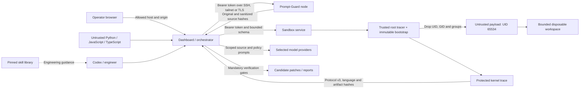

# AgentWard + MuseVerify threat model

Updated 31 October 2026 for language-adapter protocol v3. Scope: a single-operator workstation, its selected model
providers, and an operator-controlled Linux verification node. Assets include
provider credentials, source confidentiality, operator policy, host integrity,
and the correctness of accepted repair evidence.

## Trust boundaries

Source, model output, browser headers, and payload stdout are untrusted data.
The service code, Docker daemon/kernel, image, protected tracer, operator
configuration, and selected provider identities are trusted dependencies.

## Threat inventory

| ID / STRIDE class | Concrete threat | Control and validation | Remaining limit |
| --- | --- | --- | --- |
| T01 Spoofing | An unrelated website reads live telemetry or steers a local audit | Independent exact Host allowlist, same-origin validation for HTTP and WebSocket, validation before replay; browser boundary tests | Local native clients may omit Origin. Dashboard access must remain loopback or behind an authenticating proxy/tailnet policy |
| T02 Spoofing / elevation | A network peer invokes the classifier or executes arbitrary sandbox requests | Required shared node bearer token, 32-character minimum; all execution aliases tested for missing/invalid auth | Shared token identifies an authorized workstation, not individual users; rotate on operator changes |
| T03 Tampering | Source writes or replaces its own kernel evidence | Root-owned trace in an ACL-protected evidence directory, no payload capabilities, immutable bootstrap, protected protocol v3; real Python and Node tampering tests | Trusted kernel, Docker daemon, tracer, image and host administrator remain in the trusted computing base |
| T04 Tampering | A result from different source or sanitizer output is accepted | Source/harness SHA-256 binding and original/sanitized ingress hashes; mismatches rejected | Hashes bind artifacts, not semantic correctness; compromised services can still lie |
| T05 Elevation | Python startup hooks execute while the bootstrap is privileged | `python3 -I` and an immutable bootstrap; drop all groups/UID/GID before importing any submitted module; real sitecustomize test | Privileged bootstrap dependencies must come only from the trusted image |
| T06 Disclosure | Payload reads host credentials or sends network data | Only submitted files and evidence are mounted; network none, read-only root, unprivileged payload; Docker checks | Source is sent to configured model providers; provider data handling remains an operator decision |
| T07 Denial of service | Oversized JSON, classifier saturation, process floods, stdout flood or infinite code | 2 MB node/32 KiB dashboard bodies before parsing; 200k-character artifacts; 2 classifier/3 sandbox slots; CPU, memory, PID, tmpfs, file-size, output and time limits; overflow/timeout cleanup tests | Transport-level slow clients and distributed floods require reverse-proxy/firewall controls |
| T08 Tampering | Trace event cap silently hides later malicious activity | Detect the first event beyond the cap and deny complete evidence; real 600-event test | Selected syscall families and noise filters are bounded coverage, not a complete OS audit |
| T09 Repudiation | Model commentary is mistaken for proof or simulation becomes a verified repair | Existing evidence-derived reports, gate results, run IDs and simulation labels | Reports are locally writable by the trusted operator and are not a signed append-only audit service |
| T10 Tampering / supply chain | Updated or locally modified skill scripts silently change guidance | Pinned upstream revision, full-tree hashes, conflict refusal, no automatic script execution | Pinning proves identity; it does not audit every upstream procedure |
| T11 Disclosure | Redirects or ambient proxies receive node bearer tokens | Node HTTP client disables both redirects and environment proxies; redirect regression test | Plain HTTP must be carried inside SSH/Tailscale; use validated HTTPS otherwise |
| T12 Tampering / elevation | Source selects a different interpreter or fabricates language evidence | Extension registry, schema language binding, fixed runtime allowlist, response filename/language/runtime checks | Adding an adapter requires explicit parser, harness, gate and runtime tests |
| T13 Elevation / supply chain | A TypeScript project invokes compiler plugins or fetches npm packages during analysis | Non-executing Tree-sitter parsing/type erasure; official Node native loader only inside Docker; no package installation or project compiler loading | Project builds and external dependencies are unsupported; parser/runtime defects remain trusted dependencies |

## Runtime contracts

The sandbox node supports **rootful Linux Docker without user-namespace
remapping**, with POSIX ACL support on the temporary filesystem. The root tracer
has only `SYS_PTRACE`, `SETUID`, and `SETGID`; its
child drops to UID/GID 65534 with no effective/permitted capabilities before
loading submitted code. The bounding set retains the three tracer capabilities,
but `no-new-privileges`, the UID drop and empty permitted/inheritable/ambient sets
prevent the payload acquiring them through exec. Rootless/remapped deployments
are not validated; incompatible trace ownership is rejected.

The same bootstrap dispatches only to Python or Node after dropping privileges.
Node environment loader variables are explicitly cleared. The original `.ts`
source is executed by Node 24 inside Docker; type erasure on the workstation is
only a non-executing preparation step for the JavaScript CodeShield rules. This
does not perform TypeScript type checking or prove equivalence for arbitrary
compiler configurations; unsupported transformations are rejected.

Inputs and bootstrap are mounted read-only. The root filesystem is read-only.
Payload writes use a 64 MiB workspace and 16 MiB `/tmp`. A root-owned trace is
readable by the service for reporting. A POSIX ACL grants directory access only
to the service owner and root; the payload cannot read, overwrite, unlink, or
create host-backed evidence files. Unsupported ACL setup fails closed.
The service rejects symlinks, special files, wrong ownership, writable traces,
byte-limit exhaustion, event truncation, and abnormal process completion.
Docker containers are removed on completion, timeout, output overflow, or error.

The trace cannot prove every behavior, and payload-generated `PROBE` lines are
still data from an untrusted process. Positive controls, independent reviews,
CodeShield, semantic checks and regression gates remain necessary. An accepted
repair is evidence for the supported tests, not a formal proof of all behavior.

## Ownership and review triggers

The project maintainer owns application controls, release verification, the skill
pin, and image/dependency updates. The node operator owns Docker/kernel updates,
network restrictions, token rotation, image provenance, and deployment. Review
this model whenever adding a provider, tool, API route, mount, sandbox capability,
new evidence source, or multi-user access.
